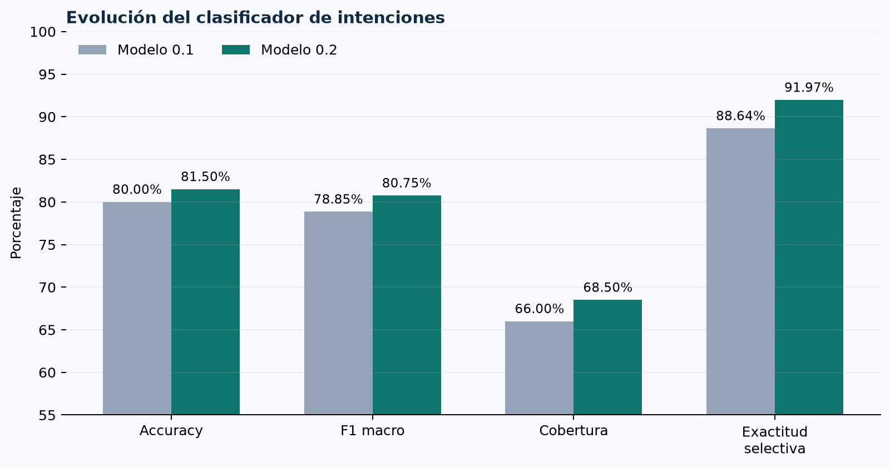
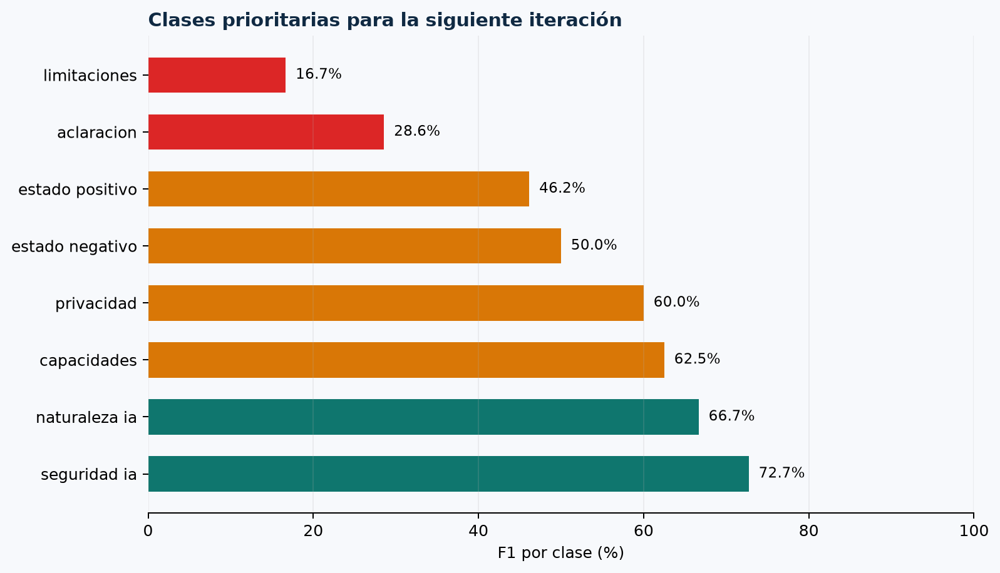
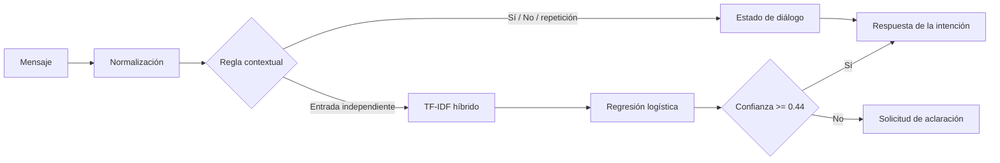

# Kenia Intent Engine


Motor conversacional ligero en español construido alrededor de un clasificador
de intenciones con rechazo por incertidumbre y una capa de estado para resolver
respuestas dependientes del contexto.

El repositorio incluye el modelo preentrenado y todos los recursos requeridos
para inferencia. El corpus de entrenamiento y los reportes internos detallados
no se distribuyen.

## Características

- 33 intenciones clasificadas estadísticamente.
- Afirmación y negación resueltas mediante el historial conversacional.
- TF-IDF híbrido de palabras y caracteres.
- Regresión logística multiclase con regularización L2.
- Rechazo automático cuando la confianza es insuficiente.
- Memoria limitada de conversación, repetición y aclaración contextual.
- Reglas para acciones no conectadas y rutas sensibles.
- Inferencia local, sin servicios externos.
- Artefacto de aproximadamente 2.1 MB comprimido.

## Resultados

La versión 0.2 fue seleccionada por F1 macro de validación. El conjunto de
prueba permaneció fuera de la selección de hiperparámetros.

| Métrica | Modelo 0.1 | Modelo 0.2 |
|---|---:|---:|
| Accuracy | 80.00% | **81.50%** |
| F1 macro | 78.85% | **80.75%** |
| Cobertura | 66.00% | **68.50%** |
| Exactitud selectiva | 88.64% | **91.97%** |
| Top-2 accuracy | — | **93.50%** |



La prueba interna contiene 200 ejemplos. Las métricas sirven como línea base y
no sustituyen una evaluación externa con conversaciones humanas.



## Modelo matemático

El texto se representa mediante dos espacios TF-IDF complementarios:

1. n-gramas de palabras de longitud 1 y 2;
2. n-gramas de caracteres de longitud 3 a 5.

Para un término $t$ en un documento $d$:

$$
\mathrm{tfidf}(t,d)=\left(1+\log \mathrm{tf}(t,d)\right)
\log\left(\frac{1+N}{1+\mathrm{df}(t)}\right)
$$

Los dos vectores se concatenan en una representación dispersa:

$$
x = \left[x_{\text{palabras}};\;x_{\text{caracteres}}\right]
$$

La probabilidad de la intención $k$ se calcula con una función softmax:

$$
P(y=k\mid x)=\frac{\exp(w_k^\top x+b_k)}
{\sum_j\exp(w_j^\top x+b_j)}
$$

Los parámetros se estiman minimizando entropía cruzada regularizada:

$$
\mathcal{L}(W,b)=
-\sum_i\log P(y_i\mid x_i)+\lambda\lVert W\rVert_2^2
$$

La regularización controla la complejidad del clasificador en un espacio de
alta dimensión. El valor de $C=1/\lambda$ se fijó en `8.0` mediante validación.

Finalmente, la inferencia aplica rechazo selectivo:

$$
\hat y =
\begin{cases}
\arg\max_k P(y=k\mid x), & \max_k P(y=k\mid x) \ge 0.44 \\
\text{desconocido}, & \text{en otro caso}
\end{cases}
$$

Esto permite intercambiar cobertura por precisión: el sistema responde cuando
existe evidencia suficiente y solicita reformulación en casos inciertos.

## Arquitectura



El clasificador no intenta resolver por sí solo mensajes como `sí` o `no`.
Esas expresiones se interpretan según el último acto del asistente. Esta
separación evita asignar una intención completa a frases sin contexto.

## Instalación

```bash
git clone <URL_DEL_REPOSITORIO>
cd kenia-intent-engine
python -m venv .venv
```

Windows:

```powershell
.venv\Scripts\Activate.ps1
pip install -e .
```

Linux o macOS:

```bash
source .venv/bin/activate
pip install -e .
```

## Uso

Chat interactivo:

```bash
kenia-chat --debug
```

Mensaje individual:

```bash
kenia-chat --once "¿qué puedes hacer?" --debug
```

También puede ejecutarse directamente:

```bash
python app.py
```

Integración desde Python:

```python
from kenia_assistant import KeniaAssistant

assistant = KeniaAssistant()

first = assistant.reply("me siento muy triste")
second = assistant.reply("sí")

print(first["response"])
print(second["response"])
```

Cada respuesta incluye información de trazabilidad:

```python
{
    "response": "Cuéntame qué ocurrió. Te escucho.",
    "intent": "afirmacion",
    "confidence": 1.0,
    "dialogue_act": "invite_details",
    "source": "context_rule"
}
```

## Estructura

```text
kenia-intent-engine/
├── .github/workflows/tests.yml
├── docs/assets/
├── src/kenia_assistant/
│   ├── resources/kenia_runtime.joblib
│   ├── chatbot.py
│   ├── cli.py
│   └── modeling.py
├── tests/test_chatbot.py
├── app.py
├── MODEL_CARD.md
├── pyproject.toml
└── requirements.txt
```

`modeling.py` contiene la especificación reproducible del estimador. El archivo
Joblib integra el clasificador, el umbral, las respuestas y la configuración
mínima de inferencia; no contiene el corpus original en formato recuperable.

## Pruebas

```bash
pip install -e .[dev]
pytest
```

La integración continua ejecuta las pruebas en Python 3.10, 3.11 y 3.12.

## Limitaciones

- La evaluación publicada utiliza una partición interna, no una prueba externa.
- Algunas fronteras semánticas todavía requieren más ejemplos contrastivos.
- El asistente no ejecuta operaciones sobre cuentas, dispositivos o servicios.
- Las reglas sensibles son una protección preliminar, no un sistema integral de seguridad.
- Los archivos Joblib solo deben cargarse desde fuentes confiables.

Para detalles adicionales consulte [MODEL_CARD.md](MODEL_CARD.md).

## Licencia

Distribuido bajo la licencia MIT.
